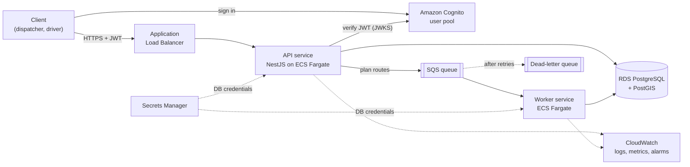

# RouteDesk

A multi-tenant SaaS backend for retail distribution logistics, built on AWS.

A distributor (a tenant) delivers goods from its depots to stores. Dispatchers manage stores, delivery zones, vehicles and orders, then request delivery routes for a day. A background worker builds the routes, and each driver sees only their own route.

This is a portfolio project. Its goal is to show how a small SaaS backend is designed and run end to end on AWS: multi-tenant data isolation, geospatial queries in PostGIS, Cognito authentication, asynchronous work over SQS, infrastructure as code with the AWS CDK, and CI/CD with GitHub Actions. Route optimization is deliberately simple. A clear heuristic with known limits matters more here than an optimal solver.

> **Status:** in progress. The repository setup, database schema, migrations and seed data are done. The geo API is next. See the [roadmap](#roadmap).

## Features

- **Tenants and roles.** Each distributor is a tenant with `admin`, `dispatcher` and `driver` users. A user can never see another tenant's data.
- **Depots and stores with locations,** stored as PostGIS `geography` points.
- **Geo queries:** stores within a radius of a point sorted by distance, the nearest stores to a depot, and which delivery zone a store belongs to.
- **Delivery zones** as polygons. Zones may overlap; a store belongs to the zone with the highest priority.
- **Orders** for a store and a delivery date, with a size that counts against vehicle capacity.
- **Asynchronous route planning.** A dispatcher requests routes for one depot and date. The API returns a job ID immediately, and a worker builds the routes:
  - orders are grouped by zone, then each vehicle's route is built with a nearest-neighbour heuristic under capacity limits;
  - vehicles may return to the depot to reload, up to a per-vehicle limit of trips;
  - each route is stored as ordered stops plus a `LineString` path and total distance;
  - orders that can't be placed (store outside every zone, no vehicle, too large) are reported with a reason instead of failing the job;
  - re-planning keeps earlier plans; one finished plan per depot and date is marked current.
- **Driver view:** `GET /me/route?date=` returns only the authenticated driver's route.

## Planned architecture



**Request flow for route planning:**

1. A dispatcher calls `POST /routes/plan` with a depot and a date.
2. The API creates a `route_jobs` row with status `queued`, sends an SQS message with the job ID, and returns `202 Accepted` with the job ID.
3. The worker receives the message, marks the job `running`, and loads the depot's zones, vehicles and orders.
4. It builds the routes and writes them in one transaction, together with the job's `done` status and the switch of the current plan. A crash halfway leaves no partial plan, and the previous plan stays current.
5. A message that keeps failing ends up in the dead-letter queue, with an alarm on its depth. Messages are handled idempotently by job ID, so a redelivered message doesn't plan twice.

**Infrastructure** (AWS CDK v2, TypeScript), split into stacks:

| Stack | Contents |
|---|---|
| Network | VPC, public subnets for Fargate tasks, isolated subnets for the database, security groups. No NAT Gateway, to keep costs near zero. |
| Data | RDS PostgreSQL with PostGIS, credentials in Secrets Manager |
| Auth | Cognito user pool, groups for roles, a custom `tenant_id` attribute |
| Messaging | SQS queue with a dead-letter queue |
| App | ECS cluster, API and worker services, Application Load Balancer, log groups |

**CI/CD** (GitHub Actions): on every pull request, lint, build, tests and `cdk diff`. On merge to `main`, build the images, push them to ECR, run migrations, then deploy. GitHub authenticates to AWS with OIDC and a narrowly scoped IAM role, so no long-lived access keys are stored anywhere.

## Multi-tenancy

All tenants share one set of tables, and every tenant-owned table has a `tenant_id` column. Isolation is enforced in layers:

- The tenant comes from the verified JWT, never from request input.
- Every query is scoped by tenant, and related rows are always loaded through the tenant-scoped data layer rather than attached by ID.
- PostgreSQL row-level security (planned) makes the database itself hide and reject other tenants' rows.
- Tests prove that a user from tenant A gets `404` for tenant B's resources.

Schema-per-tenant and composite tenant foreign keys were considered and rejected; the reasons are in the [decisions log](docs/decisions.md).

## Tech stack

| Area | Choice |
|---|---|
| Runtime | Node.js 24, TypeScript in strict mode, native ES modules |
| API | NestJS |
| Database | PostgreSQL 16 + PostGIS 3, `geography` columns in SRID 4326 with GiST indexes |
| Data access | MikroORM 7 with decorator entities; Kysely (through MikroORM) for PostGIS queries |
| Migrations | Versioned MikroORM migrations, run in CI before deploy |
| Auth | Amazon Cognito; JWTs verified in the API with `aws-jwt-verify` |
| Async work | Amazon SQS and a worker process, with a dead-letter queue |
| Infrastructure | AWS CDK v2 (TypeScript) |
| Compute | ECS Fargate behind an Application Load Balancer |
| Observability | CloudWatch logs, metrics and alarms (API 5xx rate, DLQ depth) |
| Tests | Vitest and Supertest; integration tests against a real PostGIS container with Testcontainers |
| Tooling | pnpm workspaces, oxlint (type-aware), Prettier, GitHub Actions |

## Repository layout

```
apps/
  api/          NestJS API: entities, migrations, seeders, HTTP endpoints
  worker/       SQS consumer that builds routes (planned)
packages/
  shared/       Types shared by the API and the worker: GeoJSON shapes, job statuses, queue messages
infra/          AWS CDK app (planned)
docs/
  decisions.md  Decisions log: what was decided, the alternatives, and why
```

## Data model

| Table | Purpose |
|---|---|
| `tenants` | Distributors |
| `users` | Every user of every role. Roles live in Cognito groups, not in the database. |
| `drivers` | 1:1 extension of `users` for drivers; vehicles and routes reference it |
| `depots`, `stores` | Locations as `geography(Point, 4326)` |
| `zones` | Delivery areas as `geography(Polygon, 4326)`, with a priority for overlaps |
| `vehicles` | Capacity, home depot, assigned driver, and the number of trips allowed per day |
| `orders` | Store, delivery date and size |
| `route_jobs` | Planning requests: status, depot, date, and whether the plan is current |
| `routes` | One vehicle's day for a job: path as `geography(LineString, 4326)` and total distance |
| `route_stops` | Ordered stops of a route, grouped into trips |
| `route_job_unassigned` | Orders a job couldn't place, with the reason |

## Running locally

**Requirements:** Node.js 24, pnpm, Docker.

```bash
pnpm install
cp apps/api/.env.example apps/api/.env

# Start PostGIS and the API
pnpm dev

# In another terminal: create the schema and load seed data
pnpm --filter @routedesk/api orm migration:up
pnpm seed
```

The API listens on `http://localhost:3000`, and `GET /health` returns `{ "status": "ok" }`.

The seed data is deterministic: a Kyiv distributor with one depot on each bank of the Dnipro, 200 stores, overlapping zones, vehicles with different capacities and reload limits, and orders for a fixed date. A small second tenant in Lviv exists for isolation tests. The data includes deliberate edge cases, such as stores outside every zone and an order too large for any vehicle.

**Checks:**

```bash
pnpm lint
pnpm -r build
pnpm --filter @routedesk/api test       # unit tests
pnpm --filter @routedesk/api test:e2e   # integration tests; starts a PostGIS container, needs Docker
```

## Roadmap

- [x] **Project setup:** pnpm workspaces, strict TypeScript, linting, Docker Compose with PostGIS, health endpoint, CI on every pull request
- [x] **Database schema:** all tables, geography columns, GiST indexes, seed data, database integration tests
- [ ] **Geo queries:** radius search, nearest stores, zone lookup; `EXPLAIN ANALYZE` to prove index use
- [ ] **Authentication and tenant isolation:** JWT guard, roles, tenant scoping, row-level security, cross-tenant tests
- [ ] **Route planning:** SQS, worker, idempotency, retries, dead-letter queue
- [ ] **AWS infrastructure:** network, data, auth, messaging and app stacks
- [ ] **Automated deployment:** image builds, ECR, migrations, deploys with GitHub OIDC
- [ ] **Monitoring and hardening:** structured logs, alarms, rate limiting, input validation, least-privilege IAM
- [ ] **Documentation:** final architecture, deployment guide, decisions and trade-offs

## Known limitations

These are deliberate, to keep the scope of a portfolio project manageable:

- **One home depot per vehicle.** Vehicles start, reload and finish at their own depot; multi-depot routing is out of scope.
- **No time model.** There are no shift lengths, drive times or delivery windows; a per-vehicle trip limit stands in for the length of a working day.
- **Straight-line distances.** The heuristic uses PostGIS distances, not road distances. In Kyiv, two stores on opposite banks of the Dnipro look close even though the drive crosses a bridge.
- **Role changes apply on token refresh.** Roles come from Cognito groups inside the JWT, so removing a role takes effect when the user's token expires.
